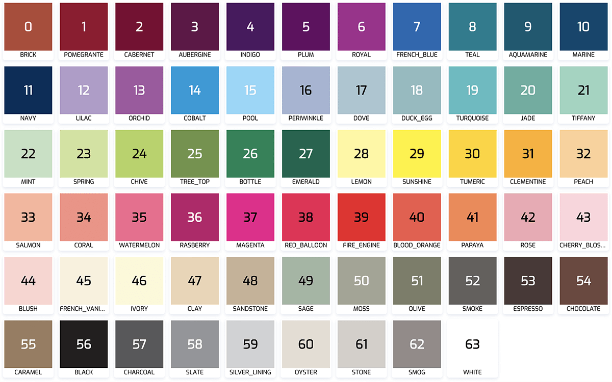

# colors


[](https://mvnrepository.com/artifact/io.rocketbase.commons/colors)





A small palette of named colors plus a few helpers to move between hex and rgb. No runtime dependencies.

```xml
<dependency>
    <groupId>io.rocketbase.commons</groupId>
    <artifactId>colors</artifactId>
    <version>0.7.0</version>
</dependency>
```

## usage

```java
RgbColor whiteRgb = RgbColor.readRgb("rgb( 255, 255, 255)");
RgbColor whiteHex = RgbColor.hex2rgb("#fff");
boolean textOnTopBlack = whiteHex.isBlackContrastingColor();

ColorPalette nearest = ColorPalette.getNearest("#a54e3c");
```

`hex2rgb` reads both the short (`#abc`) and the long (`#aabbcc`) notation, with or without the leading hash, and returns `null` for anything it cannot parse.

### release notes

- 0.7.x correctness + new build
  - **fixed `hex2rgb` for 6-digit codes**: the long notation read a single character per channel and multiplied it by 17, so only codes with repeating digit pairs such as `#ffffff` came out right. `#123456` returned (17, 51, 85) instead of (18, 52, 86). Since every `ColorPalette` entry is a 6-digit code, this affected `getNearest()` and both contrast algorithms as well — expect different results after upgrading.
  - `getHexCode()` now zero-pads single-digit channels, so `new RgbColor(5, 10, 15)` renders as `050a0f` instead of `55aaff`. Hex codes round-trip again.
  - `hex2rgb` returns `null` on invalid hex characters instead of throwing `NumberFormatException`, as the javadoc promised all along.
  - `ColorPalette.getRandomValue(Collection)` had its loop condition inverted: it only ever returned colors already contained in the collection and looped forever on an empty one.
  - jdk-11 baseline, moved from travis to github actions, switched release process to new sonatype central publishing
  - upgraded dependencies (junit 5.14.4, hamcrest 3.0, lombok 1.18.46)

- 0.6.x jsonValue + openapi info
- 0.5.x initial release
