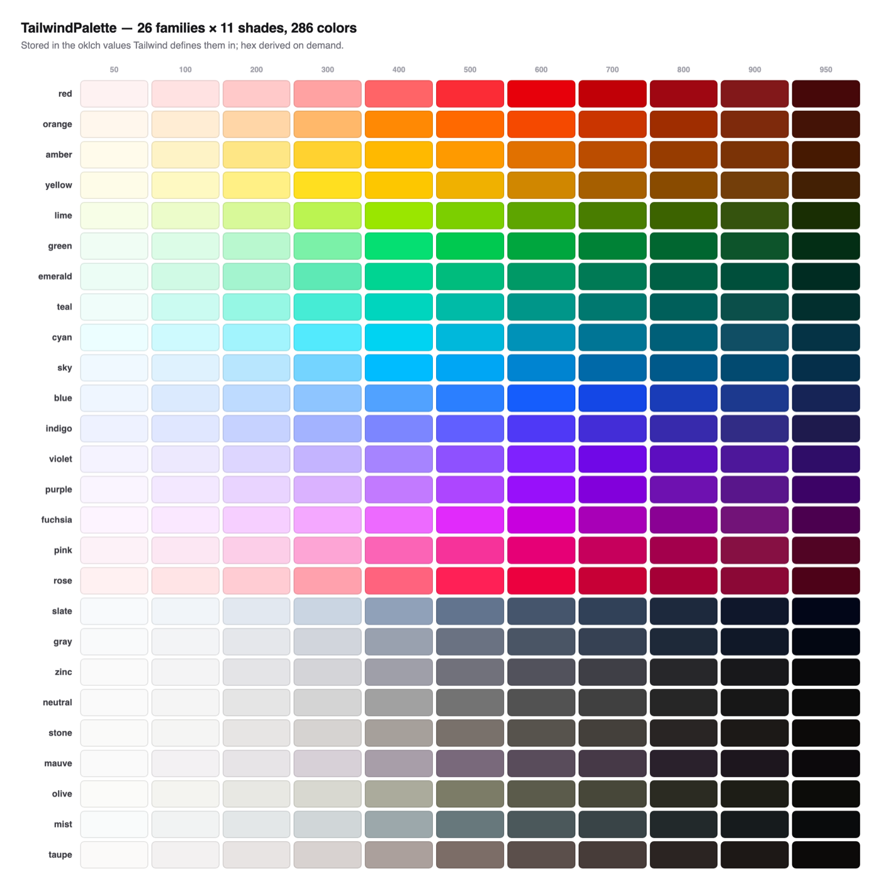
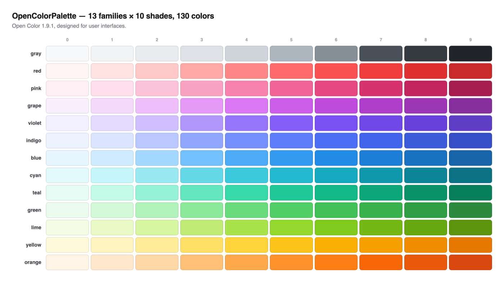
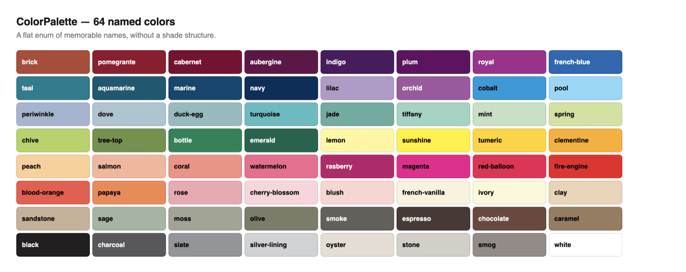

# colors

[](https://github.com/rocketbase-io/colors/actions/workflows/ci.yml)
[](https://mvnrepository.com/artifact/io.rocketbase.commons/colors)
[](https://colors.rocketbase.io/)
[](LICENSE)

Three named color palettes plus the helpers to move between hex, rgb, hsl and oklch. No runtime dependencies.

### 📖 [Documentation](https://colors.rocketbase.io/) — all palettes as swatches, usage & release notes

```xml
<dependency>
    <groupId>io.rocketbase.commons</groupId>
    <artifactId>colors</artifactId>
    <version>1.0.0</version>
</dependency>
```

## palettes

| | families | shades | total |
|---|---|---|---|
| `ColorPalette` | — | — | 64 named colors |
| `TailwindPalette` | 26 | 11 (50–950) | 286 — tracks Tailwind CSS 4.3.3 |
| `OpenColorPalette` | 13 | 10 (0–9) | 130 — tracks Open Color 1.9.1 |

#### `TailwindPalette`



#### `OpenColorPalette`



#### `ColorPalette`

Each name below is printed in the text color the library picks for that background.



The two scale-based palettes keep the family in the enum and take the shade as a parameter:

```java
String hex = TailwindPalette.EMERALD.shade(600).getHexCode();
String open = OpenColorPalette.BLUE.shade(5).getHexCodeWithLeadingHash();

// a random accent color, but never a washed out or nearly black one
TailwindShade accent = TailwindPalette.randomShade(Shade.mids());
```

Tailwind defines its colors in oklch, so that is what the enum stores — the hex code is derived on demand and clipped to the sRGB gamut the way browsers do. All 286 values match what Tailwind publishes.

## usage

```java
RgbColor whiteRgb = RgbColor.readRgb("rgb( 255, 255, 255)");
RgbColor whiteHex = RgbColor.hex2rgb("#fff");
boolean textOnTopBlack = whiteHex.isBlackContrastingColor();

// hex, rgb(), hsl() and oklch() all go through one entry point
RgbColor any = RgbColor.readColor("oklch(63.7% 0.237 25.331)");

ColorPalette nearest = ColorPalette.getNearest("#a54e3c");
TailwindShade nearestDark = TailwindPalette.getNearest(Shade.darks(), "#1a1a2e");
```

`hex2rgb` reads both the short (`#abc`) and the long (`#aabbcc`) notation, with or without the leading hash, and returns `null` for anything it cannot parse.

Nearest-color lookups compare in oklab, where distance matches what the eye sees — an rgb comparison would happily call two colors similar that look nothing alike.

Every palette implements `ColorCode`, so `getRgbColor()`, `getHslColor()`, `getOklchColor()` and the two contrast helpers work the same everywhere, and `ColorCode.getNearest(candidates, code)` searches across palettes.

### colors from

Tailwind CSS colors are MIT licensed, Copyright Tailwind Labs. Open Color is MIT licensed, Copyright (c) 2016 heeyeun.

### release notes

- 1.0.x correctness, new palettes + new build
  - **two new palettes**: `TailwindPalette` (26 families × 11 shades) and `OpenColorPalette` (13 × 10), both addressed as family + shade instead of hundreds of flat constants
  - new `Shade` enum with ranges (`lights()`, `mids()`, `darks()`, `range(from, to)`) that also drive the random helpers
  - new `ColorCode` interface shared by all palettes — `ColorPalette` implements it unchanged
  - **new color spaces**: `HslColor` and `OklchColor`/`OklabColor` with `readHsl`, `readOklch` and a combined `RgbColor.readColor(...)`
  - `getNearest()` now measures distance in oklab instead of rgb, which matches perceived similarity — results differ from 0.6.x
  - **fixed `hex2rgb` for 6-digit codes**: the long notation read a single character per channel and multiplied it by 17, so only codes with repeating digit pairs such as `#ffffff` came out right. `#123456` returned (17, 51, 85) instead of (18, 52, 86). Since every `ColorPalette` entry is a 6-digit code, this affected `getNearest()` and both contrast algorithms as well — expect different results after upgrading.
  - `getHexCode()` now zero-pads single-digit channels, so `new RgbColor(5, 10, 15)` renders as `050a0f` instead of `55aaff`. Hex codes round-trip again.
  - `hex2rgb` returns `null` on invalid hex characters instead of throwing `NumberFormatException`, as the javadoc promised all along.
  - `ColorPalette.getRandomValue(Collection)` had its loop condition inverted: it only ever returned colors already contained in the collection and looped forever on an empty one.
  - **jdk-11 baseline** — the artifact no longer loads on java 8
  - moved from travis to github actions, switched release process to new sonatype central publishing
  - upgraded dependencies (junit 5.14.4, hamcrest 3.0, lombok 1.18.46)

- 0.6.x jsonValue + openapi info
- 0.5.x initial release
